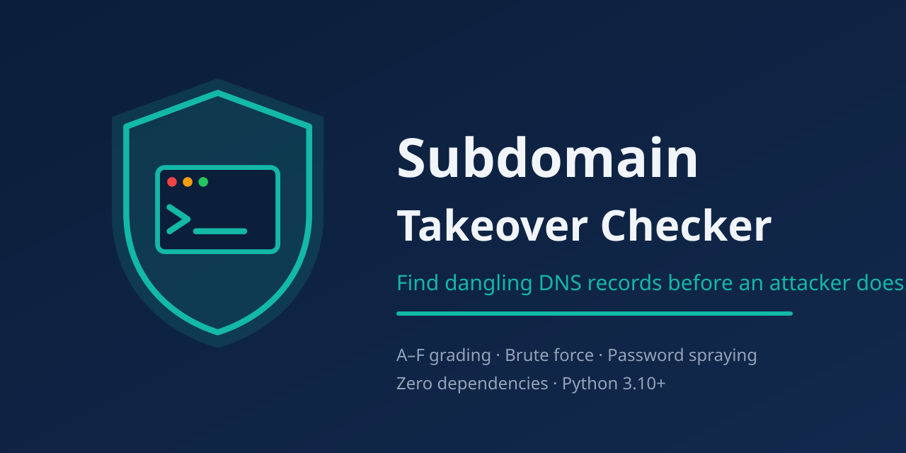
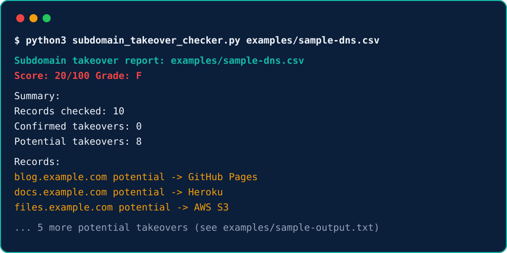
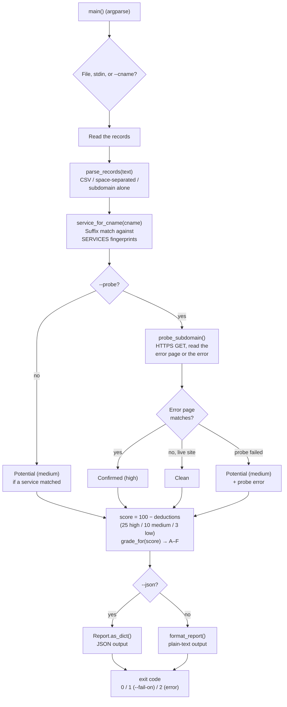

<p align="center">
  
</p>

<h1 align="center">Subdomain Takeover Checker</h1>

<p align="center"><strong>Check a domain's subdomains for dangling CNAME records that point at cloud services nobody owns, and get an A-F grade with a fix for every finding.</strong></p>

<p align="center">
  <a href="LICENSE"></a>
  <a href="https://github.com/sajidhussainraza/subdomain-takeover-checker/releases"></a>
  <a href="https://github.com/sajidhussainraza/subdomain-takeover-checker/stargazers"></a>
  <a href="https://github.com/sajidhussainraza/subdomain-takeover-checker/network/members"></a>
  <a href="https://github.com/sajidhussainraza/subdomain-takeover-checker/issues"></a>
  <a href="https://github.com/sajidhussainraza/subdomain-takeover-checker/commits/main"></a>
  <a href="https://github.com/sajidhussainraza/subdomain-takeover-checker/actions/workflows/ci.yml"></a>
  <a href="https://www.python.org/downloads/"></a>
  <a href="CONTRIBUTING.md"></a>
</p>

<p align="center">
  <a href="#demo">Demo</a> |
  <a href="#quick-start">Quick Start</a> |
  <a href="#installation">Install</a> |
  <a href="docs/demo-capture.md">Docs</a> |
  <a href="https://github.com/sajidhussainraza/subdomain-takeover-checker/issues/new?template=bug_report.yml">Report Bug</a> |
  <a href="https://github.com/sajidhussainraza/subdomain-takeover-checker/issues/new?template=feature_request.yml">Request Feature</a>
</p>

## Why this exists

**Problem:** a subdomain takeover starts with a forgotten DNS record.
A team cancels a Heroku app, deletes an S3 bucket, or moves a site off
GitHub Pages, and the CNAME record stays behind, still pointing at the
service. The subdomain is now unclaimed, and anyone can register the
same name on that service and serve their own content under your
domain, your brand, and your TLS certificate. It is one of the oldest
red-team findings, and it still shows up in real audits because DNS
records outlive the services they point at.
**Solution:** this dependency-free Python CLI takes a list of your
subdomains and their CNAME targets, matches each one against a
fingerprint database of 19 takeover-prone services, and grades the
domain A-F with a plain-language fix for every finding. With
`--probe` it fetches each subdomain and confirms the takeover by
matching the service's known "not claimed" error page, so a finding
is either confirmed or potential, never a guess.
**Result:** you know in seconds whether a domain has dangling records
left over from a cancelled service, which service each one points at,
and exactly which DNS record to delete or reclaim first.

> Only run this against domains you own or are authorised to test.
> This tool is for finding your own dangling records, not for
> scanning other people's domains.

## Demo



> Static preview, not an animated GIF: the image above is a rendering of
> real output (the full output is saved in
> [`examples/sample-output.txt`](examples/sample-output.txt)).
> A real demo GIF has not been recorded yet; the exact capture script is in
> [`docs/demo-capture.md`](docs/demo-capture.md).

## Features

- 🔍 **19 service fingerprints**: GitHub Pages, AWS S3, Heroku,
  Microsoft Azure, Shopify, Tumblr, WordPress.com, Squarespace,
  Netlify, Vercel, AWS CloudFront, Fastly, Pantheon, Zendesk,
  Bitbucket, GitLab Pages, and Surge.sh, each with its CNAME suffix
  and the distinctive error text the service shows when a subdomain
  is unclaimed
- ✅ **Confirmed vs potential**: without `--probe`, a matching CNAME
  is a potential takeover (medium); with `--probe`, a matching error
  page confirms it (high) and a live claimed site clears it
- 🛡️ **Honest probe failures**: a probe that fails (DNS, connection,
  timeout, TLS) keeps the record potential and records the error
  instead of guessing, so a network problem never becomes a false
  clean or a false alarm
- 📊 **A-F grading with a 0-100 score**: compare any two domains at a
  glance, and track a domain as you clean up its DNS
- 🗣️ **Plain-language findings, each with a fix**: no jargon, no
  guessing what to change next
- 📥 **CSV file, stdin, or inline input**: check a DNS export with
  `dns.csv`, pipe records through stdin with `-`, or test one record
  with `--cname subdomain=target`
- 🤖 **CI ready**: `--json` for machine-readable output and
  `--fail-on` to fail a build on findings above a severity, so a new
  dangling record can block a deploy
- 🪶 **Zero dependencies**: Python standard library only, nothing to install, nothing to update

## Table of contents

- [Quick Start](#quick-start)
- [Installation](#installation)
- [Usage](#usage)
- [CLI reference](#cli-reference)
- [Configuration](#configuration)
- [How grading works](#how-grading-works)
- [What it checks](#what-it-checks)
- [Live results](#live-results)
- [Architecture](#architecture)
- [Project structure](#project-structure)
- [Teaching notes](#teaching-notes)
- [Tests](#tests)
- [FAQ](#faq)
- [Roadmap](#roadmap)
- [Contributing](#contributing)
- [License](#license)
- [Acknowledgements](#acknowledgements)

## Quick Start

The fastest path to a working result, under 60 seconds. You need only
Python 3.10+; there is nothing to install.

```bash
git clone https://github.com/sajidhussainraza/subdomain-takeover-checker.git
cd subdomain-takeover-checker
python3 subdomain_takeover_checker.py examples/sample-dns.csv
```

Expected output (real output, captured 24 November 2026; the full
output with all 8 findings is saved in
[`examples/sample-output.txt`](examples/sample-output.txt)):

```
Subdomain takeover report: examples/sample-dns.csv
Score: 20/100  Grade: F

Summary:
  Records checked: 10
  Confirmed takeovers: 0
  Potential takeovers: 8
  CNAMEs to other services: 1
  Records with no CNAME: 1

Records:
  blog.example.com             potential -> GitHub Pages
  docs.example.com             potential -> Heroku
  files.example.com            potential -> AWS S3
  shop.example.com             potential -> Shopify
  help.example.com             potential -> Zendesk
  app.example.com              potential -> Microsoft Azure
  old.example.com              potential -> Tumblr
  cdn.example.com              potential -> AWS CloudFront
  www.example.com              no cname
  api.example.com              unknown

Findings (8):
  [MEDIUM] blog.example.com: Potential subdomain takeover: blog.example.com points at GitHub Pages (sajid.github.io) and the service was not probed, so it is not known whether the subdomain is claimed. A CNAME to a takeover-prone service that nobody owns can be claimed by an attacker.
        Fix: Run with --probe to confirm, or check the GitHub Pages account for blog.example.com. Claim the subdomain by adding it to a GitHub Pages site, or remove the CNAME.
  [MEDIUM] docs.example.com: Potential subdomain takeover: docs.example.com points at Heroku (cyberlegends.herokuapp.com) and the service was not probed, so it is not known whether the subdomain is claimed. A CNAME to a takeover-prone service that nobody owns can be claimed by an attacker.
        Fix: Run with --probe to confirm, or check the Heroku account for docs.example.com. Claim the subdomain in a Heroku app, or remove the CNAME.
```

The sample export is deliberately a domain full of dangling records,
which is why it scores 20/100, grade F. A clean domain scores 100/100,
grade A (see [Usage](#usage)).

## Installation

### Prerequisites

| Requirement | Version | Notes |
| --- | --- | --- |
| Python | 3.10 or newer | 3.10+ is required: the code uses `str \| None` annotations (PEP 604). Check with `python3 --version`. |
| Git | Any recent version | Only needed to clone the repo; you can also download the ZIP from GitHub. |
| A DNS export | None | A CSV of `subdomain,cname` records from your DNS provider, or one record with `--cname`. The sample file in `examples/` works without one. |
| Third-party packages | None | Standard library only (`argparse`, `csv`, `json`, `urllib`). There is no `requirements.txt` because there is nothing to install. |

### Getting your DNS records

Export the CNAME records for a domain you own, then feed them to the
tool. Any of these works:

```bash
# With dig: list CNAMEs for the subdomains you know about
dig +short blog.example.com CNAME
dig +short docs.example.com CNAME

# Or export the zone from your DNS provider (Cloudflare, Route 53,
# your registrar) as a CSV, then keep the subdomain and CNAME columns.
```

The input format is one record per line: `subdomain,cname` (a header
row is skipped), or space-separated, or a subdomain alone when it has
no CNAME. Lines starting with `#` and blank lines are ignored.

### Windows

```powershell
git clone https://github.com/sajidhussainraza/subdomain-takeover-checker.git
cd subdomain-takeover-checker
py subdomain_takeover_checker.py examples\sample-dns.csv
```

Use `py` (the Python launcher) if `python3` is not recognised. On
Windows, `python` usually works too.

### macOS

```bash
git clone https://github.com/sajidhussainraza/subdomain-takeover-checker.git
cd subdomain-takeover-checker
python3 subdomain_takeover_checker.py examples/sample-dns.csv
```

macOS ships a system Python that may be older than 3.10. If
`python3 --version` reports below 3.10, install a newer Python from
[python.org](https://www.python.org/downloads/) or with
`brew install python`.

### Linux

```bash
git clone https://github.com/sajidhussainraza/subdomain-takeover-checker.git
cd subdomain-takeover-checker
python3 subdomain_takeover_checker.py examples/sample-dns.csv
```

Most current distributions already ship Python 3.10+. On Debian/Ubuntu,
`sudo apt install python3` gets you a working interpreter.

### Install from source

There is no package to install and no build step. Cloning the repo
*is* the install: `subdomain_takeover_checker.py` is a single
self-contained file. Copy it anywhere and run it:

```bash
cp subdomain_takeover_checker.py /usr/local/bin/subdomain-takeover-checker   # optional, Linux/macOS
chmod +x /usr/local/bin/subdomain-takeover-checker
subdomain-takeover-checker dns.csv
```

### Verify the install

```bash
python3 tests/run_tests.py   # 45 tests, all offline
python3 subdomain_takeover_checker.py examples/sample-dns.csv
```

The second command should print `Score: 20/100  Grade: F` and exit 0
(the sample export is a domain full of dangling records; the grade is
the point).

### Troubleshooting

| Error | Cause | Fix |
| --- | --- | --- |
| `python3: command not found` | Python is not installed, or not on PATH | Install Python 3.10+ from python.org; on Windows use `py` instead of `python3` |
| `Error: could not read dns.csv (...)` (exit 2) | No permission to read the file, or the path is wrong | Check the path, or copy the export to a readable location first |
| `Error: Give a DNS file to check, or records with --cname` (exit 2) | No file and no `--cname` were given | Give one or the other, not neither |
| `Error: --cname value must be subdomain=target` (exit 2) | A `--cname` value had no `=` | Use the form `--cname blog.example.com=sajid.github.io` |
| `SyntaxError` on `str \| None` | Python older than 3.10 | Upgrade to Python 3.10+; this syntax (PEP 604) does not work on 3.8/3.9 |
| Score 100 on a domain you know is dangling | The CNAME is not in the export, or the service is not in the fingerprint list | Check the export includes the CNAME column, and check `--list-services` for the service |
| Every probe fails with a connection error | The subdomain does not resolve, or the network blocks the request | A failed probe keeps the record potential and records the error; check the service account by hand, and re-run once the subdomain resolves |

## Usage

### Basic: check a DNS export

This is the core use case: a quick check of a domain's DNS records.

```bash
python3 subdomain_takeover_checker.py dns.csv
```

A clean domain with no CNAME to a takeover-prone service looks like
this (real output, 24 November 2026):

```bash
python3 subdomain_takeover_checker.py --cname www.example.com=example.com
```

```
Subdomain takeover report: DNS records
Score: 100/100  Grade: A

Summary:
  Records checked: 1
  Confirmed takeovers: 0
  Potential takeovers: 0
  CNAMEs to other services: 1
  Records with no CNAME: 0

Records:
  www.example.com              unknown

Findings (1):
  [INFO] dns: No subdomain takeover exposure found: no CNAME points at a takeover-prone service, or every probed subdomain is claimed and serving a live site.
        Fix: Keep checking: DNS records change whenever a service is cancelled. Re-run this tool after any migration or decommission.
```

### Intermediate: check one record, and confirm with a probe

```bash
python3 subdomain_takeover_checker.py --cname blog.example.com=sajid.github.io
```

```bash
cat dns.csv | python3 subdomain_takeover_checker.py -
```

With `--probe`, the tool fetches each subdomain over HTTPS and
matches the response against the service's unclaimed error page. A
matching error page confirms the takeover (high); a live claimed site
clears it. A probe that fails keeps the record potential and records
the error. Real output from the sample export, 24 November 2026
(the `example.com` subdomains in the sample do not resolve, so every
probe failed and the records stayed potential, with the error shown):

```bash
python3 subdomain_takeover_checker.py examples/sample-dns.csv --probe --timeout 5
```

```
Subdomain takeover report: examples/sample-dns.csv
Score: 20/100  Grade: F

Summary:
  Records checked: 10
  Confirmed takeovers: 0
  Potential takeovers: 8
  CNAMEs to other services: 1
  Records with no CNAME: 1
  Probes that failed: 8

Records:
  blog.example.com             probe error -> GitHub Pages
      RemoteDisconnected: Remote end closed connection without response
  docs.example.com             probe error -> Heroku
      RemoteDisconnected: Remote end closed connection without response
  ...
```

A confirmed takeover, when the probe matches the service's unclaimed
error page, is reported as a high finding in this form (the confirm
path is covered by tests against a local HTTP server; no real
unclaimed subdomain was probed to produce it, because probing a
subdomain you do not own is out of scope for this tool):

```
  [HIGH] blog.example.com: Confirmed subdomain takeover: blog.example.com points at GitHub Pages (sajid.github.io) and the live site shows the service's unclaimed error ("There isn't a GitHub Pages site here."). Anyone can claim this subdomain on the service right now.
        Fix: Claim blog.example.com in the GitHub Pages account immediately, or delete the CNAME record. Claim the subdomain by adding it to a GitHub Pages site, or remove the CNAME.
```

Machine-readable output for scripts and dashboards:

```bash
python3 subdomain_takeover_checker.py examples/sample-dns.csv --json
```

```json
{
  "source": "examples/sample-dns.csv",
  "counts": {
    "records": 10,
    "checked": 10,
    "potential": 8,
    "confirmed": 0,
    "unknown_services": 1,
    "no_cname": 1,
    "probe_errors": 0
  },
  "score": 20,
  "grade": "F",
  "findings": [
    {
      "severity": "medium",
      "source": "blog.example.com",
      "message": "Potential subdomain takeover: blog.example.com points at GitHub Pages (sajid.github.io) and the service was not probed, so it is not known whether the subdomain is claimed. A CNAME to a takeover-prone service that nobody owns can be claimed by an attacker.",
      "fix": "Run with --probe to confirm, or check the GitHub Pages account for blog.example.com. Claim the subdomain by adding it to a GitHub Pages site, or remove the CNAME."
    }
  ],
  "results": [
    {
      "subdomain": "blog.example.com",
      "cname": "sajid.github.io",
      "service": "GitHub Pages",
      "status": "potential",
      "probe_detail": null
    }
  ]
}
```

(The full JSON, with all 10 results and all 8 findings, is saved in
[`examples/sample-output.json`](examples/sample-output.json). The
`findings` and `results` lists above are shortened to the first entry
for readability.)

List the services the tool recognises:

```bash
python3 subdomain_takeover_checker.py --list-services
```

```
Takeover-prone services (19 fingerprints):

  GitHub Pages
    CNAME suffix: *.github.io
    Unclaimed error text: "There isn't a GitHub Pages site here."
  AWS S3
    CNAME suffix: *.s3.amazonaws.com
    Unclaimed error text: 'NoSuchBucket'
  ...
```

### Advanced: use it as a CI security gate

Fail a build when the DNS export has high-severity findings, for
example in a nightly job that exports a domain's DNS and checks it:

```bash
python3 subdomain_takeover_checker.py dns.csv --fail-on high
echo $?   # 1: a confirmed takeover was found; 0: clean at that level
```

Combine it with `--json` to feed the findings into your own reporting:

```bash
python3 subdomain_takeover_checker.py dns.csv --probe --json --fail-on medium > takeover-report.json
```

#### Exit codes

| Code | Meaning |
| --- | --- |
| 0 | No findings at or above `--fail-on` |
| 1 | Findings at or above `--fail-on` were found |
| 2 | Usage error (missing file, bad flags, unreadable export) |

Note: the checker only sees the records you give it. A subdomain
missing from the export is invisible to it, and a CNAME to a service
that is not in the fingerprint database is reported as unknown, not
clean. The fingerprint list is the well-known public one (in the style
of the can-i-take-over-xyz research); a service can change its error
page, so `--probe` reports the response it actually saw.

## CLI reference

| Flag / argument | Description |
| --- | --- |
| `dnsfile` (positional) | Path to a CSV file of `subdomain,cname` records, e.g. `dns.csv`. Use `-` to read from stdin. |
| `--cname SUBDOMAIN=TARGET` | One record given on the command line, e.g. `--cname blog.example.com=sajid.github.io`. Repeatable, and can be combined with a file. |
| `--probe` | Fetch each subdomain over HTTPS and confirm a takeover by matching the service's unclaimed error page. Without this, matches are reported as potential. |
| `--timeout SECONDS` | Seconds to wait for each probe response. Default: `10`. |
| `--json` | Print the report as JSON instead of plain text. |
| `--fail-on {high,medium,low,none}` | Exit 1 when findings at or above this severity are found. Default: `none` (always exit 0 unless there is a usage or file error). |
| `--list-services` | List the takeover-prone services this tool recognises, then exit. |
| `--version` | Print the version and exit. |
| `-h`, `--help` | Show the built-in help and exit. |

## Configuration

There is no configuration file and no environment variable to set.
Every behaviour is controlled by the command-line flags above.

| Option | Type | Default | Description |
| --- | --- | --- | --- |
| `dnsfile` | string | None | CSV file of `subdomain,cname` records, or `-` for stdin. |
| `--cname` | string (repeatable) | None | One `subdomain=target` record on the command line. |
| `--probe` | flag | off | Fetch each subdomain and confirm by error page. |
| `--timeout` | int | 10 | Seconds to wait for each probe response. |
| `--json` | flag | off | JSON output instead of plain text. |
| `--fail-on` | `high` / `medium` / `low` / `none` | `none` | Severity threshold that makes the exit code 1. |
| `--version` | flag | None | Print the version (`1.0.0`) and exit. |
| `--list-services` | flag | None | Print the fingerprint database and exit. |

No secrets are involved anywhere: the tool reads a local file and,
with `--probe`, makes plain HTTPS requests. DNS exports are sensitive
(real subdomains reveal your infrastructure), so redact them before
sharing a sample.

## How grading works

Score starts at 100 and deducts **25 / 10 / 3** per high / medium / low
finding:

| Score | Grade |
| --- | --- |
| 90-100 | A |
| 80-89 | B |
| 70-79 | C |
| 60-69 | D |
| 0-59 | F |

Findings are graded by severity:

| Severity | Examples |
| --- | --- |
| High | Confirmed takeover (probe matched the service's unclaimed error page) |
| Medium | Potential takeover (CNAME matches a takeover-prone service, unprobed or probe failed) |
| Low | (None yet; reserved for weaker signals such as a CNAME to a discontinued service) |
| Info | No takeover exposure found (no deduction) |

## What it checks

| Check | What a good result looks like |
| --- | --- |
| GitHub Pages (`*.github.io`) | No CNAME points at an unclaimed GitHub Pages site |
| AWS S3 (`*.s3.amazonaws.com`, `*.s3-website-*`) | No CNAME points at a deleted bucket |
| Heroku (`*.herokuapp.com`) | No CNAME points at a deleted Heroku app |
| Microsoft Azure (`*.azurewebsites.net`, `*.trafficmanager.net`) | No CNAME points at a deleted App Service |
| Shopify (`*.myshopify.com`) | No CNAME points at a closed store |
| Tumblr (`*.tumblr.com`) | No CNAME points at a deleted blog |
| WordPress.com (`*.wordpress.com`) | No CNAME points at an unregistered site |
| Squarespace (`*.squarespace.com`) | No CNAME points at a deleted site |
| Netlify (`*.netlify.app`) | No CNAME points at a deleted site |
| Vercel (`*.vercel.app`) | No CNAME points at a deleted project |
| AWS CloudFront (`*.cloudfront.net`) | No CNAME points at a deleted distribution |
| Fastly (`*.fastly.net`) | No CNAME points at a deleted service |
| Pantheon (`*.pantheonsite.io`) | No CNAME points at a deleted site |
| Zendesk (`*.zendesk.com`) | No CNAME points at a closed help centre |
| Bitbucket (`*.bitbucket.io`) | No CNAME points at a deleted workspace |
| GitLab Pages (`*.gitlab.io`) | No CNAME points at a deleted project |
| Surge.sh (`*.surge.sh`) | No CNAME points at a deleted project |
| Probe confirmation (`--probe`) | A matching error page confirms, a live site clears, a failed probe stays potential |
| Malformed lines | None: every line parses (malformed lines are skipped and counted, never fatal) |

Three subtleties are handled, not just pattern-matched:

- A CNAME match alone is only ever "potential". Claiming a subdomain
  on a service is a separate fact from pointing a CNAME at it, and
  the tool does not call a record vulnerable until `--probe` has seen
  the service's own unclaimed error page.
- A failed probe is not treated as clean and not treated as
  confirmed. A subdomain that does not resolve yet is exactly the
  kind of record that needs a human to check the service account,
  so the tool says so and keeps the finding.
- The fingerprint match is a suffix match on the CNAME target, not a
  substring match. `notgithub.io` does not match GitHub Pages, and
  the match is case-insensitive with a trailing dot stripped, because
  DNS names are case-insensitive and zone exports often end in a dot.

Known limitation: the tool reads the records you give it. It does not
enumerate subdomains and does not query DNS itself, so a subdomain
missing from your export is invisible to it. It also cannot tell a
CNAME that points at a service you still use from one that points at
a service you cancelled; that is what `--probe` and the service
account are for. See the [roadmap](#roadmap).

## Live results

Real analysis of the shipped sample export, captured 24 November 2026.
The full outputs are saved in [`examples/`](examples/).

| Export | Score | Grade | What stood out |
| --- | --- | --- | --- |
| [`examples/sample-dns.csv`](examples/sample-dns.csv) (10 records) | 20/100 | F | 8 potential takeovers across 8 services (GitHub Pages, Heroku, AWS S3, Shopify, Zendesk, Azure, Tumblr, CloudFront), 1 record with no CNAME, 1 CNAME to an unrecognised service |
| Same export, `--probe --timeout 5` | 20/100 | F | All 8 probes failed (the `example.com` subdomains do not resolve), so the records stayed potential with the error shown; a failed probe never clears a finding |
| One clean record (`--cname www.example.com=example.com`) | 100/100 | A | No CNAME to a takeover-prone service, reported as an info finding |

The sample export deserves a careful read rather than a shrug: it is a
synthetic export (all subdomains are under `example.com`), but every
record in it is a record a real domain produces after a service is
cancelled and the DNS is forgotten. The point of the tool is that a
human reading 10 records would spot the problem; a human reading
1,000 records would not.

## Architecture



The tool is a single file with no dependencies: `parse_records` turns
text into records, `service_for_cname` is a pure fingerprint lookup,
`check_records` is a pure function of its inputs apart from the
optional live probe (so it is easy to test offline with synthetic
records), and the output layer is separate from the analysis.

## Project structure

```
subdomain-takeover-checker/
├── subdomain_takeover_checker.py  # The whole tool: parse, match, probe, grade, report
├── README.md                      # This file
├── LICENSE                        # MIT
├── CHANGELOG.md                   # Version history (Keep a Changelog + SemVer)
├── CONTRIBUTING.md                # How to contribute
├── CODE_OF_CONDUCT.md             # Contributor Covenant 2.1
├── SECURITY.md                    # How to report a vulnerability
├── .gitignore                     # Python / editor / OS artefacts
├── .editorconfig                  # Indentation and line endings
├── assets/
│   ├── banner.svg                 # README banner (1280x640)
│   ├── logo.svg                   # Square logo, works at 64px
│   └── demo.svg                   # Static terminal preview shown above
├── docs/
│   └── demo-capture.md            # Exact script for recording a real demo.gif
├── examples/
│   ├── sample-dns.csv             # Synthetic 10-record export: 8 potentials, 1 no-CNAME, 1 unknown
│   ├── sample-output.txt          # Real text output for the sample export
│   └── sample-output.json         # Real JSON output for the sample export
├── tests/
│   ├── test_subdomain_takeover_checker.py  # 45 tests (stdlib unittest)
│   └── run_tests.py               # Test runner, no pytest needed
└── .github/
    ├── ISSUE_TEMPLATE/
    │   ├── bug_report.yml
    │   ├── feature_request.yml
    │   └── config.yml
    ├── PULL_REQUEST_TEMPLATE.md
    └── workflows/
        └── ci.yml                 # Tests on Ubuntu / Windows / macOS, Python 3.10-3.13
```

## Comparison with alternatives

Skipped: no competing tools were given to compare against, so there is
no comparison table here. If you know a subdomain takeover checker
this should be measured against, open a
[feature request](https://github.com/sajidhussainraza/subdomain-takeover-checker/issues/new?template=feature_request.yml)
and it can be added with real, verifiable numbers.

## Teaching notes

This tool pairs well with a lesson on subdomain takeover: run it
against the sample export, then add `--probe` and watch what changes
(and what does not). Good discussion points:

- Why a dangling CNAME is a takeover, not just a broken link: the
  attacker does not need to break into anything, they just claim the
  same name on the same service, and the DNS you already published
  does the rest.
- Why a CNAME match alone is only "potential": pointing at a service
  is not the same as the service being unclaimed, and a tool that
  calls every GitHub Pages CNAME a takeover would be ignored the
  first time it cried wolf on a live site.
- Why a failed probe stays potential instead of becoming clean: the
  subdomain that does not resolve is exactly the record most likely
  to be dangling, and treating a network error as "all clear" is how
  a real takeover gets missed.
- Why DNS records outlive services: cancelling a service is one click
  in one console, and deleting the DNS record is a different click in
  a different console, owned by a different person, on a different day.
- Why the fix is either reclaim or delete, never just "monitor": a
  potential takeover is a race, and the attacker only needs to claim
  the name once.
- Why suffix matching matters: a substring match would flag
  `notgithub.io` as GitHub Pages, and a checker that flags the wrong
  service teaches students to distrust the tool.

### Lab exercise for students

1. Run the tool on `examples/sample-dns.csv` and note the score.
2. Open the export and delete the GitHub Pages and Heroku lines. Run
   the tool again: what changed, and what did not?
3. Now add a line `blog.example.com,sajid.github.io` back with
   `--cname` instead of editing the file. What is the score now?
4. Run the tool with `--probe` on the sample export. Why do all 8
   probes fail, and why does the score stay 20/100?
5. As a stretch goal: add a fingerprint of your own (for example, a
   service your team uses) with a test, and open a pull request.

## Tests

```bash
python3 tests/run_tests.py   # 45 tests, all offline
```

45/45 tests pass. The tests cover fingerprint matching (including
trailing dots, case, and substring non-matches), CSV and
space-separated parsing, header rows, malformed lines, `--cname`
flags, potential vs confirmed vs clean vs probe-error outcomes,
probe confirmation against a local HTTP server, grading boundaries,
JSON output shape, `--fail-on` exit codes, and the shipped sample
export scoring 20/100, grade F. (pytest is also supported if it is
installed: `python3 -m pytest tests/ -q`.)

## FAQ

**Why does the sample export score 20/100?**
Because it is deliberately a domain full of dangling records: 8
medium findings (10 points each) deduct 80 points. A clean domain
scores 100. The sample export is built to show the potential finding
across 8 different services at once.

**Why is a potential takeover medium, not high?**
Because a CNAME pointing at a service does not prove the service is
unclaimed. The subdomain might be a live site. High is reserved for
a takeover `--probe` has confirmed by seeing the service's own
unclaimed error page. That distinction is what keeps the tool
trustworthy.

**Why does a failed probe not clear the finding?**
Because the most likely reason a subdomain does not resolve is that
the service behind it is gone, which is exactly the condition that
makes a takeover possible. Clearing it on a network error would hide
the riskiest records.

**Why does the tool not enumerate subdomains or query DNS itself?**
Because enumeration is a different tool's job, and querying DNS for
every subdomain would make the tool slow and network-dependent. The
design is deliberate: you export the records you already have, and
the tool grades them offline. Subdomain enumeration is on the
roadmap as an optional `--enumerate` mode.

**Why is there no `--resolve` check?**
For the same reason: the tool checks the records you give it, and a
CNAME that points at a takeover-prone service is a finding whether
or not the subdomain currently resolves. A record that resolves
today can stop resolving tomorrow when the service is cancelled.

**Does it work on Windows?**
Yes. Any machine with Python 3.10+ runs it; use `py` instead of
`python3` if that is how Python is launched on your machine. CI tests
it on Ubuntu, Windows, and macOS. `--probe` needs network access to
the subdomains being checked.

**Can I use it in CI?**
Yes. `--json` gives machine-readable output and `--fail-on` turns
findings into a failing build. See
[Advanced usage](#advanced-use-it-as-a-ci-security-gate).

**Does it send anything anywhere?**
Only with `--probe`, and only plain HTTPS GET requests to the
subdomains in your own export. Without `--probe` it makes no network
calls at all. The only thing that leaves your machine is what you
choose to paste into an issue, and DNS exports should be redacted
before sharing.

**What if a service changes its error page?**
Then `--probe` will stop confirming that service, and the record
will stay potential instead of being confirmed. That is the safe
failure mode: the tool reports what it saw. Open an issue with the
new error text and the fingerprint can be updated.

## Roadmap

- [ ] Record a real `demo.gif` (capture script: [`docs/demo-capture.md`](docs/demo-capture.md))
- [ ] Add an `--enumerate` mode that discovers subdomains first
  (wordlist + DNS resolution), so the tool can start from a domain
  instead of an export
- [ ] Add a `--resolve` check that reports CNAME targets which no
  longer resolve at all
- [ ] Add more service fingerprints (help-wanted: verify each one
  with a real unclaimed error page first)
- [ ] Add a `--dns-server` option for the probe's DNS lookups
- [ ] HTML report output alongside text and JSON
- [ ] Publish to PyPI (only if there is demand; the single-file script works fine as-is)

## Contributing

Contributions are welcome. See [CONTRIBUTING.md](CONTRIBUTING.md) for
the full guide. The short version:

1. Fork the repository and create a branch for your change.
2. Keep the tool dependency-free (Python standard library only).
3. Add or update tests in `tests/` for any behaviour you change.
4. Run the full suite and make sure all 45 tests pass:
   `python3 tests/run_tests.py`
5. Open a pull request describing the change and why it helps.

Please also follow the [Code of Conduct](CODE_OF_CONDUCT.md), and
report security issues privately as described in
[SECURITY.md](SECURITY.md), do not open a public issue for them.

## License

MIT. See [LICENSE](LICENSE) for the full text.

## Acknowledgements

- The subdomain takeover research community, and the public
  fingerprint collections in the style of can-i-take-over-xyz, for
  the error strings this tool matches against.
- [OWASP](https://owasp.org/www-community/attacks/Subdomain_takeover)
  for the attack description behind the checks.
- The [Contributor Covenant](https://www.contributor-covenant.org/) for
  the Code of Conduct, and [Keep a Changelog](https://keepachangelog.com/)
  for the changelog format.
- Everyone who reports a wrong score with a real DNS export to back
  it up: that is how the checks get better.

## Star history

[](https://star-history.com/#sajidhussainraza/subdomain-takeover-checker&Date)

## Contributors

[](https://github.com/sajidhussainraza/subdomain-takeover-checker/graphs/contributors)

---

Built by [Cyber Legends](https://cyberlegends.org), cybersecurity
trainings, services and solutions.

**If this saved you time, please star the repo.**
